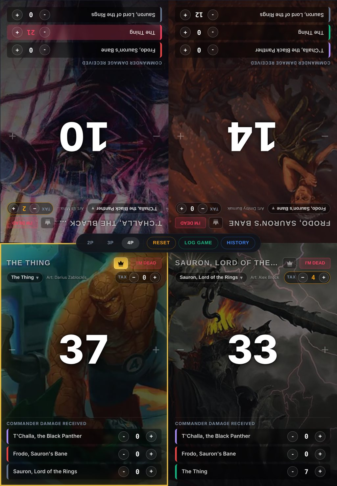
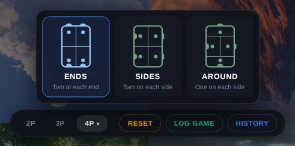
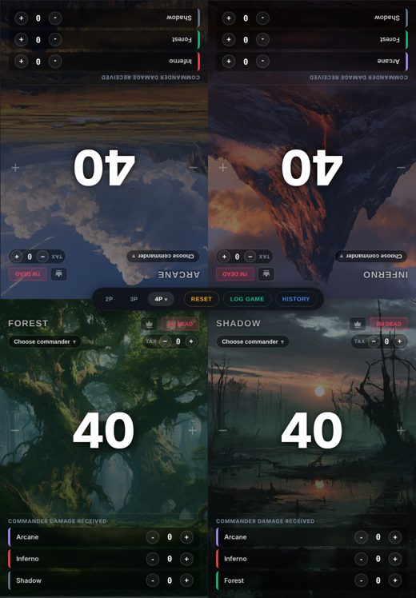
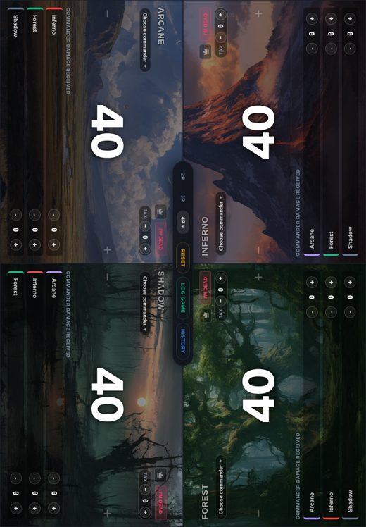
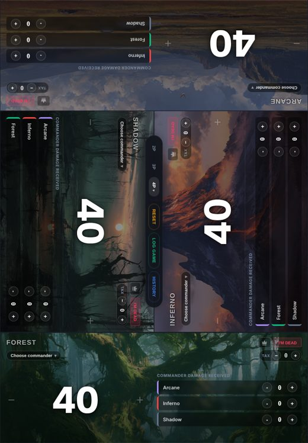
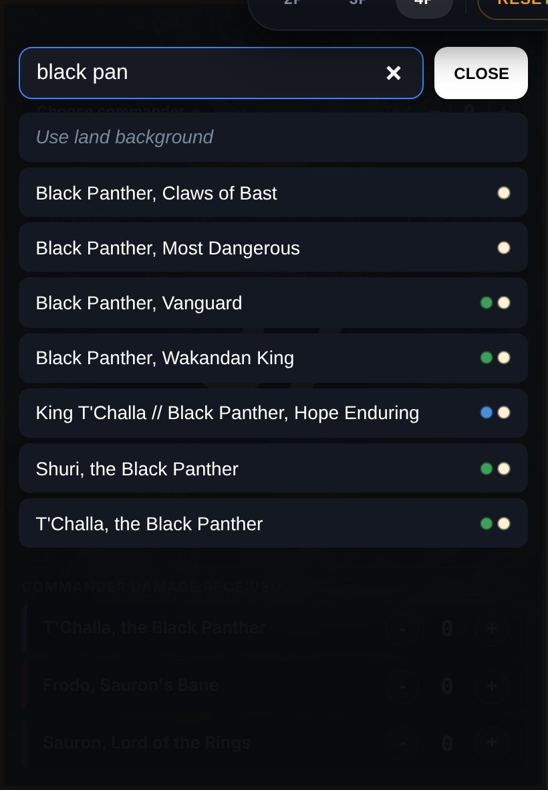
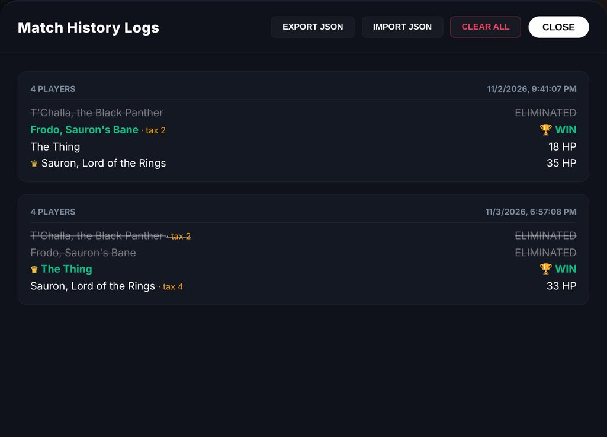

# Urza's Abacus

**The Commander life tracker that does the counting.** A free, zero-install life tracker for **Magic: The Gathering Commander (EDH)**, built for **one tablet lying flat in the middle of the table**.

It handles life, commander damage, commander tax, the monarch, and eliminations for 2–4 players. Each seat can show its commander's card art and color identity, and finished games go into a match history you can export and import.

No app store, no account, no build step. Open `app/index.html` and play.


**▶ Play it now:** https://dougvanslembrouck.github.io/urzas-abacus/app/

**Website:** https://dougvanslembrouck.github.io/urzas-abacus/

<p align="center">
  
</p>

---

## Contents

- [Why Urza's Abacus?](#why-urzas-abacus)
- [Features](#features)
- [Quick start](#quick-start)
- [How to use it at the table](#how-to-use-it-at-the-table)
- [Controls at a glance](#controls-at-a-glance)
- [Commander art](#commander-art)
- [Match history](#match-history)
- [Customizing](#customizing)
- [Project structure](#project-structure)
- [Browser support](#browser-support)
- [Privacy](#privacy)
- [Known limitations](#known-limitations)
- [Roadmap](#roadmap)
- [Contributing](#contributing)
- [License and credits](#license-and-credits)

---

## Why Urza's Abacus?

Urza was Magic's greatest artificer, and an abacus is the oldest counting machine there is. Together they're a fair description of this app: a well-made tool that keeps count so your pod doesn't have to.

Most life counters track a number per player. A Commander pod needs more than that, and Urza's Abacus covers it:

- **Commander damage that does the math.** Adding commander damage also takes it off life, and a row turns red at 21.
- **Your commander, on your seat.** Pick your commander and its art becomes your background, with its color identity shown as mana pips. Your seat is named after it everywhere.
- **The monarch and commander tax.** Both are tracked on the card, so nobody has to remember.
- **Built for a shared device.** Seats on the far side are rotated so everyone reads their own total, and the controls sit in the middle where everyone can reach them.
- **A record of your pod.** Every logged game keeps names, commanders, final life, tax, the monarch, and the winner.

---

## Features

### Table layouts
- **2, 3, or 4 players**, switched from the control bar in the center of the screen.
- **Built for a tablet in portrait**, lying flat with players around it.
- **Every seat faces its player.** Each card is turned so its player reads it right side up.
  - **2P:** face to face, one at each end.
  - **3P:** two seats at the top, one full-width seat at the bottom.
  - **4P:** three layouts to match how your pod sits (below).
- **Center control bar.** 2P / 3P / 4P, Reset, Log Game, and History sit on the line where the seats meet. Each card leaves room for it, so it never covers a name or button.

### Four-player layouts
Tap **4P** to choose how the four seats face the table. Your choice is remembered on that tablet: next time, **4P** goes straight to it. Tap **4P** again while in a four-player game to switch.

| Layout | Where players sit | Best for |
|---|---|---|
| **Ends** | Two at each short end of the tablet | A long table, two players on each end |
| **Sides** | Two along each long side, cards turned 90° | A long table with the tablet lengthwise between two rows of players |
| **Around** | One on each side: full-width bands at the top and bottom, two side seats in the middle | A square or round table, one player per side |

In **Sides** and **Around**, the center bar turns to lie along the middle seam, where every side-facing card's top edge meets. In **Around**, all four seats get the same screen area, and the top and bottom bands put life on the left and commander damage on the right. Seats are numbered clockwise in both.

<p align="center">
  
</p>

<p align="center">
  
  &nbsp;
  
  &nbsp;
  
</p>

### Life total
- Everyone starts at **40**.
- **Tap anywhere on the right half** of the life area to gain 1, and **anywhere on the left half** to lose 1. That includes tapping on the number itself. Faint `−` and `+` marks show which side is which.
- On rotated seats, "right" is the player's own right.
- The number is large (up to 96px) and scales with the card so it never crowds the tap areas.
- Fast tapping doesn't trigger the browser's double-tap zoom.
- Life can go below zero.

### Commander damage
- Each card has a **Commander Damage Received** panel with one row per opponent, color-coded to that opponent's seat.
- **Adding commander damage also subtracts that life.** Removing it gives the life back.
- At **21 or more** from one commander, the row turns red and pulses.
- Damage can't go below 0. Rows for empty seats are hidden in 2P and 3P.

### Commander art and names
- Tap **Choose commander** to search every commander-legal card on Scryfall, live. New sets, like the Star Trek releases, show up as soon as Scryfall lists them.
- Picking one sets the seat's background to the card's art, credits the artist, shows the commander's **color identity as mana pips** under the tax counter, and **renames the seat to the commander**, both on the card and in every opponent's damage rows.
- Full details are under [Commander art](#commander-art).

### Commander tax
- A **Tax** counter beside the commander button counts in steps of 2 (0 → 2 → 4 → 6…). The number is exactly the extra mana the next cast costs.
- It turns amber once a player has tax, and it can't go below 0.

### Color identity
- Under the tax counter, each seat shows its commander's **color identity as mana symbols**, in the order printed on cards (Boros shows {R}{W}, Esper {W}{U}{B}).
- Colorless commanders show {C}. Seats using a land background show no pips.
- The symbols come from Scryfall. Offline, each pip falls back to a colored circle with its letter.

### Monarch
- Tap the **crown** next to I'm Dead to make a player the monarch. Their card gets a gold border and a gold crown.
- Only one monarch at a time. Crowning someone takes the crown from whoever had it, and tapping the current monarch's crown removes it.
- If the monarch is eliminated, the crown is cleared. Tap it onto the new monarch, since the app doesn't track turns.
- Switching to a smaller layout clears the crown from a seat that's no longer in play.

### Elimination
- **I'm Dead** dims the card, turns its art greyscale, and locks its controls. The button becomes **Undo** in case of a mis-tap.

### Reset
- **Reset** (with a confirmation) sets everyone back to 40, clears commander damage and tax, removes the monarch, and revives eliminated players.
- Names, commanders, and the layout stay, so the same pod can start the next game right away.

### Match history
- **Log Game** saves the game. **History** shows every logged game, newest first.
- **Export JSON**, **Import JSON**, and **Clear All** let you back up or move your history. See [Match history](#match-history).

---

## Quick start

### Play in your browser
Open **https://dougvanslembrouck.github.io/urzas-abacus/app/** on the tablet you'll put on the table. The website at https://dougvanslembrouck.github.io/urzas-abacus/ explains every feature and has an **Open the app** button.

### Add it to your home screen
It then opens full screen like an app:
- **iPad (Safari):** Share → *Add to Home Screen*
- **Android tablet (Chrome):** ⋮ menu → *Add to Home screen*

### Run it from your computer
1. Download this repository (green **Code** button → **Download ZIP**) and unzip it.
2. Double-click `app/index.html`. (The `index.html` at the top level is the website.)

Keep the `app` folder together. `app/index.html` needs the `css`, `js`, and `images` folders next to it.

### Host your own copy on GitHub Pages
1. Fork this repository.
2. In your fork, open **Settings → Pages**.
3. Under **Build and deployment**, choose **Deploy from a branch**, then the `main` branch and the `/ (root)` folder, and **Save**.
4. After a minute or two your copy is live: the website at `https://<your-username>.github.io/<repo-name>/` and the app at `…/<repo-name>/app/`.

---

## How to use it at the table

**Before the game**
1. Lay the tablet flat in the middle of the table, in portrait.
2. Tap **2P**, **3P**, or **4P** on the center bar. For 4P, pick **Ends**, **Sides**, or **Around** to match where everyone sits.
3. Each player taps **Choose commander** on their card, types part of the commander's name, and picks it. Or tap your seat name to type your own name instead.

**During the game**
- **Life:** tap the right side of your life total to gain, the left side to lose.
- **Commander damage:** on the card of the player who took the damage, use `+` on the row for the commander that dealt it. Their life drops by the same amount.
- **Commander tax:** tap `+` on **Tax** each time you recast your commander from the command zone.
- **Monarch:** tap the crown on whoever becomes the monarch.
- **Knocked out:** tap **I'm Dead**. Tap **Undo** if it was a mistake.

**After the game**
1. Mark eliminated players with **I'm Dead** so the right winner is recorded.
2. Tap **Log Game**.
3. Tap **Reset** for the next game. Names and commanders carry over.

**Who gets the win?** If exactly one player is left alive, they win. Otherwise, the surviving player(s) with the highest life win, and ties share the win. Eliminated players never count.

---

## Controls at a glance

| Where | Control | What it does |
|---|---|---|
| Center bar | **2P / 3P / 4P** | Changes the number of seats. **4P** opens the layout chooser the first time, and again whenever you tap it during a four-player game |
| Center bar | **Reset** | Starts a new game (after confirming) |
| Center bar | **Log Game** | Saves the current game to match history |
| Center bar | **History** | Opens match history |
| Card header | **Name** | Tap to type a player name |
| Card header | **Crown** | Makes this player the monarch, or removes it |
| Card header | **I'm Dead / Undo** | Eliminates or revives this player |
| Below the name | **Choose commander ▾** | Opens the commander search |
| Below the name | **Tax − / +** | Changes commander tax by 2 |
| Under Tax | **Mana pips** | Shows the commander's color identity (display only) |
| Life area | **Left half / right half** | Loses / gains 1 life |
| Damage panel | **− / +** on a row | Changes commander damage from that opponent, and life with it |

---

## Commander art

<p align="center">
  
</p>

**Searching.** Type at least 2 letters. After a short pause in typing, the app searches Scryfall's full list of commander-legal paper cards. Each word you type must match the start of a word in the card's name, so `tchalla`, `black pan`, `frodo sau`, `sauron lord`, and `kirk` all work. Apostrophes and accents are ignored. Names that start with what you typed come first. Press **Enter** to pick the top result and **Esc** to close. Each result shows its color identity as mana symbols.

**Which art you get.** When you pick a commander, the app asks Scryfall for its newest *standard* printing: available in nonfoil, not a promo, and not a showcase, extended-art, etched, or other "booster fun" variant. When several printings came out the same day, a bordered one beats a borderless alternate, then the lowest collector number wins. For example:

- **T'Challa, the Black Panther** uses its regular Marvel Super Heroes Commander printing, not the foil promo.
- **Kirk, Commanding Officer** uses the regular Star Trek printing (#243, art by Cliff Nielsen), not the borderless alternate.

Commanders that only exist in special versions use Scryfall's default printing. The artist of the printing shown is always credited on the card.

**Names.** Picking a commander renames the seat to the commander's name. Long names end in "…" when space is tight. **Use land background** switches back to the seat's land art and restores its default name, unless the player has typed their own name since.

**Remembered.** Each seat's commander (name, color identity, artist, and art link) is saved on the device and restored the next time you open the app, even without internet. Picks saved by v2.0 are looked up again automatically.

**Internet.** Searching and picking need internet, because they ask Scryfall directly. Nothing is downloaded or stored in advance. Without a connection, the picker says it can't reach Scryfall, saved commanders keep their names, and a seat whose art can't load keeps its land background.

### Seat themes

When no commander is picked, each seat shows a basic land under a tinted overlay.

| Seat | Default name | Land | Tint | Damage-row color |
|---|---|---|---|---|
| 1 | Arcane | Plains | Mystic purple | Purple |
| 2 | Inferno | Mountain | Volcanic red | Red |
| 3 | Forest | Forest | Deep pine green | Green |
| 4 | Shadow | Swamp | Obsidian grey | Slate |

---

## Match history

<p align="center">
  
</p>

Each logged game shows the player count, date and time, and every player's name, commander, final life or elimination, tax, and the monarch (♛). Winners are marked 🏆.

History is saved in your browser on that device. **Export JSON** downloads it as a file, which you can back up or **Import JSON** on another device. Imported games are added to the ones already there. **Clear All** erases everything after a confirmation.

### Data format

Exported files are a JSON array of match records:

```json
[
  {
    "id": "match_1793750400000",
    "timestamp": "11/3/2026, 9:20:00 PM",
    "mode": "4 Players",
    "players": [
      { "id": 1, "name": "T'Challa, the Black Panther", "lifeLeft": 0,  "isDead": true,  "isMonarch": false, "commanderTax": 2, "commander": "T'Challa, the Black Panther" },
      { "id": 2, "name": "Frodo, Sauron's Bane",        "lifeLeft": 0,  "isDead": true,  "isMonarch": false, "commanderTax": 0, "commander": "Frodo, Sauron's Bane" },
      { "id": 3, "name": "The Thing",                   "lifeLeft": 18, "isDead": false, "isMonarch": true,  "commanderTax": 0, "commander": "The Thing" },
      { "id": 4, "name": "Doug",                        "lifeLeft": 35, "isDead": false, "isMonarch": false, "commanderTax": 4, "commander": null }
    ],
    "winners": [4]
  }
]
```

| Field | Meaning |
|---|---|
| `id` | Unique ID from the time the game was logged |
| `timestamp` | Local date and time the game was logged |
| `mode` | `"2 Players"`, `"3 Players"`, or `"4 Players"` |
| `players[].id` | Seat number, 1–4 |
| `players[].name` | Name shown for that seat when the game was logged |
| `players[].lifeLeft` | Final life total |
| `players[].isDead` | Whether the player was eliminated |
| `players[].isMonarch` | Whether the player held the crown at the end |
| `players[].commanderTax` | Final commander tax |
| `players[].commander` | Commander name, or `null` for the land background |
| `winners` | Seat numbers of the winner(s); more than one on a tie, empty if nobody survived |

Files exported from v1.x import fine. Those games simply have no commander, monarch, or tax fields.

---

## Customizing

Most settings live in **`app/js/config.js`**:

| Setting | Default | What it controls |
|---|---|---|
| `STARTING_LIFE` | `40` | Life at the start and after Reset |
| `LETHAL_COMMANDER_DAMAGE` | `21` | When a damage row turns red |
| `COMMANDER_TAX_STEP` | `2` | How much each tax tap adds |
| `SEATS` | Arcane, Inferno, Forest, Shadow | Default names, theme, and damage-row color per seat |
| `COMMANDER_PICKER_MAX_RESULTS` | `40` | How many search results show at once |
| `COMMANDER_SEARCH_DELAY_MS` | `300` | How long to wait after typing before searching Scryfall |
| `SCRYFALL_STANDARD_PRINTING` | nonfoil, not promo… | Which printings count as "standard" for commander art |

**Land backgrounds** are in `app/images/lands/`. Replace a file with your own image of the same name, or change the paths in `app/css/player-card.css` under *Seat themes*.

---

## Project structure

The app follows a **Model–View–Controller** pattern with each kind of file in its own folder. It's plain HTML, CSS, and JavaScript, with no frameworks and no build step.

```
.
├── index.html                    The website (one page, explains every feature)
├── favicon.svg                   Icon
├── images/
│   ├── site/                     Pictures for the website
│   └── screenshots/              Pictures for this README
├── app/                          The app itself
│   ├── index.html                  Page shell + HTML templates for the player card
│   ├── favicon.svg                 App icon
│   ├── css/                        One stylesheet per part of the screen
│   │   ├── base.css                  reset, color tokens, animations
│   │   ├── layout.css                2P / 3P layouts, the three 4P layouts, seat rotation
│   │   ├── player-card.css           card, themes, life, monarch, tax, commander damage
│   │   ├── commander-picker.css      commander search overlay
│   │   ├── hud.css                   centered control bar and 4P layout chooser
│   │   └── history.css               match history panel
│   ├── js/
│   │   ├── config.js               Rules and seat setup
│   │   ├── utils/                  Event emitter, safe storage, DOM helpers, mana pips
│   │   ├── models/                 Data and rules (never touch the page)
│   │   │   ├── GameModel.js          life, damage, eliminations, monarch, tax, names, commanders, layout
│   │   │   ├── HistoryModel.js       logged games, import / export / clear
│   │   │   └── CommanderCatalog.js   live Scryfall search, standard printing, artist
│   │   ├── views/                  Draw the screen, report taps (no game rules)
│   │   │   ├── BoardView.js          the table
│   │   │   ├── PlayerCardView.js     one player card
│   │   │   ├── CommanderPickerView.js search overlay
│   │   │   ├── HudView.js            control bar and layout chooser
│   │   │   └── HistoryView.js        history panel
│   │   ├── controllers/            Connect views to models
│   │   │   ├── GameController.js
│   │   │   ├── CommanderController.js
│   │   │   └── HistoryController.js
│   │   └── app.js                  Starts the app
│   └── images/lands/               Seat backgrounds
├── releases/                     Release notes
├── docs/ARCHITECTURE.md          How the app's code fits together
└── .github/ISSUE_TEMPLATE/       Bug report and feature request forms
```

**How a tap flows through the app:** a view reports the tap → a controller calls the model → the model applies the rules and announces a change → the controller redraws the views. See **[docs/ARCHITECTURE.md](docs/ARCHITECTURE.md)** for the full walkthrough.

---

## Browser support

**Urza's Abacus is designed for tablets** (iPad, Android tablets, and similar), held in **portrait**. It opens on a phone or a computer, but layouts aren't tuned for small screens, and landscape isn't tuned yet.

Any current browser works: Chrome or Edge 105+, Safari 16+ (iPadOS 16+), Firefox 110+. The layout relies on CSS container queries, which older browsers don't support.

---

## Privacy

- No accounts, no ads, no analytics, no cookies.
- Match history and commander picks are stored only in your browser on that device.
- The only outside requests go to Scryfall: commander searches and lookups to `api.scryfall.com` while you use the commander picker, art images from `cards.scryfall.io` for picked commanders, and mana symbols from `svgs.scryfall.io`. No personal information is sent.

---

## Known limitations

- **Commander search needs internet.** It asks Scryfall live, so there's no offline list. Saved commanders still show their names offline.
- **A game in progress isn't saved.** Refreshing mid-game resets life, damage, tax, the monarch, and typed names. Logged games and commander picks are kept.
- **21 commander damage doesn't eliminate automatically.** The row warns you, but the player still taps **I'm Dead**.
- **One commander per player.** Partners and backgrounds don't get their own art, damage rows, or tax counter yet.
- **Other counters** (poison, energy, experience, the initiative) aren't tracked yet.
- **Tablet only, portrait only.** Phones aren't supported, and landscape isn't tuned yet.
- **Long names.** Long commander names are shortened with "…" when space is tight, mostly in the 4P Ends layout.
- **Import doesn't skip duplicates.** Importing the same file twice adds those games twice.
- **History stays on one device.** Use Export / Import to move it.
- **Land images are large** (about 1.5 MB each), so the first load on a slow connection can take a few seconds.

---

## Roadmap

- Save the game in progress across refreshes
- Optional auto-eliminate at 21 commander damage or 0 life
- Partner commanders and backgrounds
- Poison counters and an Initiative / Undercity tracker
- Turn tracker and game timer
- Win rates per player and per commander
- Configurable starting life (20 for duels, 30 for Brawl) from the app
- Smaller, faster-loading background images
- In-app confirmations instead of browser pop-ups

Ideas and votes are welcome in [Issues](../../issues).

---

## Contributing

Bug reports, ideas, and pull requests are welcome. Start with **[CONTRIBUTING.md](CONTRIBUTING.md)**, and see **[CHANGELOG.md](CHANGELOG.md)** for what changed in each version.

---

## License and credits

Code is released under the **[MIT License](LICENSE)** © 2026 Doug Vanslembrouck.

Urza's Abacus was called the *NJA EDH Pod Life Tracker* up to v2.1.0. Saved history and commander picks from those versions carry over.

Card data, art images, and mana symbols are provided by **[Scryfall](https://scryfall.com)**. Card art is credited to its artists in the app and is copyright Wizards of the Coast.

This is unofficial Fan Content permitted under the [Wizards of the Coast Fan Content Policy](https://company.wizards.com/en/legal/fancontentpolicy). It is not approved or endorsed by Wizards. Portions of the materials used are property of Wizards of the Coast. ©Wizards of the Coast LLC. *Magic: The Gathering* is a trademark of Wizards of the Coast LLC.
